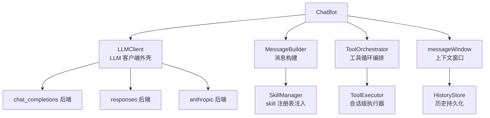
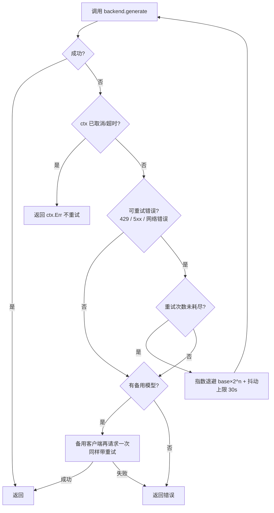
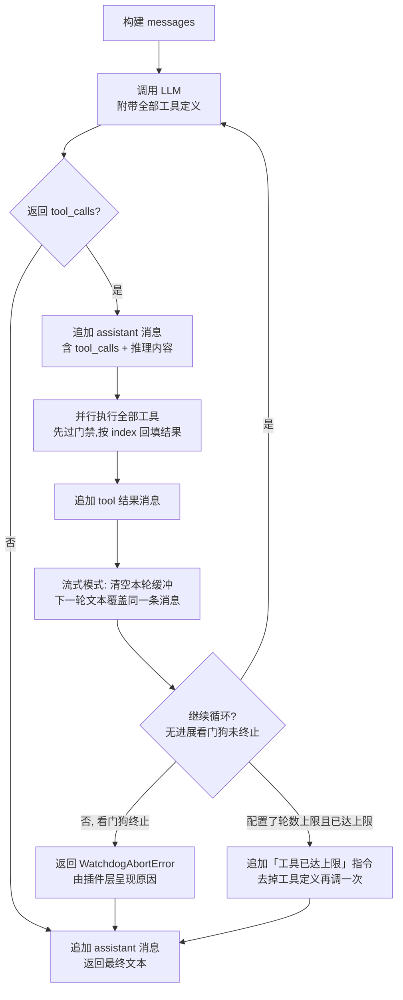

# AI 引擎（一）LLM 客户端与对话循环

本章介绍 AI Agent 的**核心循环**：从用户消息到 LLM 请求之间的全部技术细节 —— 三种 LLM API 格式如何统一、重试与备用模型、消息如何构建、多轮工具调用如何编排。

## ChatBot 的组成

`bot/component/aichat` 中每个会话对应一个 `ChatBot`，它由四个组件组合而成：



- `NewChatBot(baseURL, apiKey, model, prompt, maxContextTokens, toolExecutor, historyStore, opts...)`
- 主对话 / 子代理 / 定时任务 / OCR 各自创建独立 ChatBot；子代理与定时任务跟随主模型（同一个模型四元组），压缩器与备用模型可另配，OCR 独立配置
- `SetMaxIterations` 控制工具循环轮数上限（主对话与子代理均取主模型的「最大工具调用轮数」配置；默认 0 = 不限制，负数归一为 0）

## LLMClient：多格式统一外壳

`LLMClient` 是插拔式后端的薄外壳，统一提供**应用层重试**与**备用模型切换**，三种 API 格式作为 `llmBackend` 接口的实现：

```go
type llmBackend interface {
    generate(ctx context.Context, messages []Message, opts ChatOptions) (GenerateResponse, TokenUsage, error)
    generateStream(ctx context.Context, messages []Message, opts ChatOptions) (resp GenerateResponse, usage TokenUsage, started bool, err error)
}
```

| 格式 | 实现 | 说明 |
| --- | --- | --- |
| `chat_completions` | `llmbackend_chatcompletions.go` | OpenAI Chat Completions（默认，DeepSeek 等绝大多数兼容 API），经 `openai-go/v3` |
| `responses` | `llmbackend_responses.go` | OpenAI Responses API，同一 SDK 的 `responses` 包 |
| `anthropic` | `llmbackend_anthropic.go` | Anthropic Messages API，`anthropics/anthropic-sdk-go` |

各后端负责**自己的消息转换、请求发送、流式累积与用量映射**；外层 `LLMClient` 不关心格式差异。

### 格式差异的抹平

三种协议的差异在各自后端内部消化：

- **system 提示词**：chat_completions/responses 作为 system 消息，anthropic 走独立的 `system` 参数
- **工具调用**：各自映射为 `tool_calls` / `tool_use` 结构，统一成内部 `llmtool.ToolCall{ID, Name, Arguments}`
- **max_tokens**：Anthropic 必填，未配置时默认 8192；且大 max_tokens 非流式请求会被 Anthropic 强制要求流式，后端统一走流式通道内部聚合，对外仍表现为一次性返回
- **深度思考**：
  - Anthropic extended thinking：`thinking.mode` 映射为 `budget_tokens`；thinking 块（含 signature / redacted data）序列化到 `Message.ThinkingBlocks`，多轮工具调用中**原样回传**（API 强制要求）；开启 thinking 时不允许下发 temperature/top_p/top_k
  - DeepSeek 风格 `reasoning_content` 存入 `Message.ReasoningContent`，同样在 tool calling 多轮中原样传回

### 重试与备用模型



- SDK 已内置 408/409/429/5xx 指数退避；本层补充 SDK 不覆盖的网络错误并自定义退避节奏，两层叠加
- 流式模式下**已输出首字节后失败不重试、不切换备用**——避免用户看到重复输出
- 所有等待尊重 ctx 剩余 deadline，取消/超时立即返回

### Token 用量语义

```go
type TokenUsage struct {
    PromptTokens     int  // 多轮累加（计费用）
    CompletionTokens int
    TotalTokens      int
    CachedTokens     int  // 上游 prompt 缓存命中（DeepSeek / OpenAI cached_tokens）
    LastPromptTokens int  // 最后一次调用的 prompt 数 = 当前上下文真实大小
    Iterations       int  // LLM 调用轮数
}
```

`LastPromptTokens` 与 `PromptTokens` 的区分是压缩阈值判断正确性的关键：前者代表上下文真实长度（用于触发压缩），后者是跨工具轮次的累加值（只适合计费统计）。

## 请求级保护：超时与流空闲看门狗

放开回合总超时后，上游挂死必须由**单次请求**兜底（`llmguard.go`）：

- **请求总超时**（`llm.request_timeout_sec`，默认 600s）：每次尝试（含重试、备用模型切换）在 `LLMClient` 出口派生带 deadline 的 context，三种 API 格式后端统一生效；超时错误包裹 `context.DeadlineExceeded`，按普通可重试错误进入重试/备用模型逻辑。
- **流式空闲看门狗**（`llm.stream_idle_timeout_sec`，默认 120s）：按「连续多久没有新数据块」计时，后端每读到一个块（内容/思考/工具参数增量/usage）调用 `notifyStreamActivity` 重置；只要模型还在出字，单次请求总时长超过阈值也不会误杀。触发时取消本次请求并改写为可识别的超时错误。
- anthropic 后端的非流式 `generate` 内部走流式通道，同样套用空闲看门狗；`chat_completions`/`responses` 的非流式请求在响应返回前没有增量，只受请求总超时约束。

## 消息构建

`MessageBuilder` 负责把系统提示词、历史、当前输入组装成 LLM 请求：

```go
func (b *MessageBuilder) BuildChatMessages(userInput string, history []Message) []Message {
    // [system: basePrompt + skill 注册表] + history... + [user: [时间] 用户输入]
}
```

- 每条用户消息前缀 `[时间]`，让模型感知当前时间（工具调用的 time 结果与之呼应）
- system prompt 由「插件配置的提示词 + skill 可用列表 + 当前对话场景」组成，场景注入（`buildScenePrompt`）告诉 AI 自己在群聊还是私聊、消息 ID 前缀含义、记忆/知识库能力说明
- 图片上下文用 `BuildImageContextMessage`：每张图片前附 `[图片 <hash>]` 文本标签，与消息文本中的图片标记一致，便于 AI 区分和引用具体图片

## ToolOrchestrator：多轮工具调用循环

这是 Agent 的核心循环：**LLM → 工具调用 → 执行 → 结果回填 → LLM……** 直到模型不再请求工具。



### 关键细节

- **并行执行**：同一轮的多个工具调用并发执行（goroutine + WaitGroup），结果按 `index` 预分配回填，保证 tool 结果消息与 assistant 消息中 `tool_calls` 的顺序一一对应（OpenAI API 要求）；单个工具 panic 转为错误文本回填，不传染进程
- **工具门禁**：每个工具在 goroutine 内、真正执行前先过请求级门禁（`ChatOptions.PreToolGate`：计划模式 → PreToolUse 钩子 → 人工审批），被拦时门禁文本作为该工具的结果回填、循环继续；执行完成后触发 `PostToolUse` 钩子（仅通知）。详见 [AI 引擎（三）](/internals/agent-tools#工具门禁管线)；用户消息进入对话前还会触发 `UserPromptSubmit` 钩子（可阻断/注入上下文）
- **运行中追加输入（steering）**：`ChatOptions.Steer` 是可选回调，工具循环在**每次发起 LLM 请求前**调用它排空已到达的追加输入，回调返回的文本**原样**作为 user 消息插入本轮上下文（前缀由回调自带，编排层不再追加 `[追加指令]`）；正在执行的那一批工具不会被中断。异步子代理的 `subagent_send` 基于它：`steerDrain` 给每条指令加 `[追加指令]` 前缀，通道有 8 格缓冲，满了丢弃新指令并给调用方返回提示（不阻塞工具执行）。主会话的运行中插话复用同一机制，由 `buildInterjectionSteer` 排空会话队列并加 `【用户插话】`/`【后台消息】` 前缀（见 [AI 引擎（三）](/internals/agent-tools) 的「运行中插话」）。
- **回调串行化**：工具回调（发消息、图片加载队列等）内部可能修改共享状态，`lockedCallbacks` 用同一把互斥锁串行化；发送顺序可能不再等于调用顺序，但结果回填顺序不受影响
- **流式边界**：流式模式下每轮增量直接发到平台，**全程只维持一条消息**；工具边界调用 `OnStreamRoundEnd` 清空本轮累积缓冲，下一轮文本从零累积并整体覆盖这条消息（Patch 是覆盖语义），最终留下的就是最后一轮的最终回复
- **轮数上限与看门狗**：默认 `maxIterations=0` 表示不限制，循环只能由「模型给出最终回复 / 无进展看门狗终止 / 上层取消（`/stop`、硬截止、关停）」结束；配置为正数时保留旧语义——到达上限后追加「工具调用已达限制，请直接回答」并移除工具定义再调一次。看门狗（`WatchdogOptions`，由插件层按 `turn.*` 填充）在每轮工具调用前检查：相同工具+参数连续重复按 `repeat_tool_warn`（3/5/8）提醒，达到 `no_progress_limit`（12）时返回 `WatchdogAbortError` 终止本轮；工具轮数达到 `progress_reminder_after`（6）时注入一次委派提醒；`soft_timeout_sec` 到达时注入一次「收尾或转后台」提醒（不取消）。提醒均以 user 角色追加、随本轮返回值进入历史。
- **单请求内上下文保护**：每步 LLM 返回后若 prompt token 超过窗口的 85%，`pruneContextMessages` 把较旧的大工具结果裁成「标记 + 原始长度 + 头尾片段」，保留最近 6 条消息与 tool_call 配对，避免长工具循环撑爆窗口导致整批请求失败（窗口级压缩见 [AI 引擎（二）](/internals/agent-context)）。
- **中间轮文本**：非流式模式下工具轮的 assistant 文本**不发送**——只发送最后一轮的最终回复（中间轮常是「边想边说」的草稿，发出去会与最终回复重复刷屏）；`callbacks.SendText` 保留给工具/宿主显式发送消息，定时任务/子代理的 SendText 回调则丢弃（仅记日志），见 [AI 引擎（三）](/internals/agent-tools)

### 图片加载的注入时机

工具执行后若 `TakeLoadedImages` 队列非空（`load_images` / `local_image` / `screenshot` 工具推入），在回填工具结果之后追加一条图片上下文消息，让多模态模型下一轮看到图片：

```go
if imageURLs := callbacks.TakeLoadedImages(); len(imageURLs) > 0 {
    messages = append(messages, o.msgBuilder.BuildImageContextMessage(imageURLs))
}
```

## 会话内请求串行化与回合预算

插件层用会话运行器保证同一会话同一时刻只有一个进行中的回合（`runner.go`）：

- **入口零阻塞**：消息事件只做门禁/命令/入队并立即返回，后台运行器按会话串行执行；长回合既不占用框架事件 goroutine，也不受 `bot.msg_event_timeout_sec` 约束
- **会话锁**（`tryLock`）：基于缓存层 `SetString + WithCheckExist + TTL` 的**分布式锁**（Redis 后端可跨实例），10 分钟自动过期防死锁
- **并发槽**：`rateCh` 限制全局**对话回合**并发（`plugin.ai_chat_bot.rate_limit`，默认 4）；后台子代理使用独立池（`subagent.max_concurrent_global`，默认 8），不挤占对话
- **回合预算三层**：软截止 `turn.soft_timeout_sec`（默认 600s）只注入收尾提醒；硬截止 `turn.hard_timeout_sec`（默认 14400s，0=不限）取消回合；看门狗负责重复调用/无进展。回合上下文丢弃框架 deadline（`context.WithoutCancel`）但关联插件生命周期
- **运行中插话**：回合进行中到达的消息进入**待处理队列**（每会话上限 20 条），工具循环在**每次 LLM 请求前**经 `ChatOptions.Steer` 把它排空并作为 user 消息注入当前对话——用户消息带 `【用户插话】` 前缀、子代理完成通知等合成消息带 `【后台消息】` 前缀，模型下一步就能回应，不必等整轮结束；最后一批请求开始后才到达的消息留在队列里，由运行器在本批结束后作为下一批处理。`/stop` 取消当前回合并清空队列，`/stop <任务ID>` 只取消指定后台子代理

## 下一步

- [AI 引擎（二）上下文、历史与记忆](/internals/agent-context) —— 上下文窗口如何按 token 预算压缩、历史如何持久化
- [AI 引擎（三）工具、MCP 与高级编排](/internals/agent-tools) —— 工具如何定义、MCP 如何懒加载、定时任务与子代理
- [技术原理总览](/internals/)

