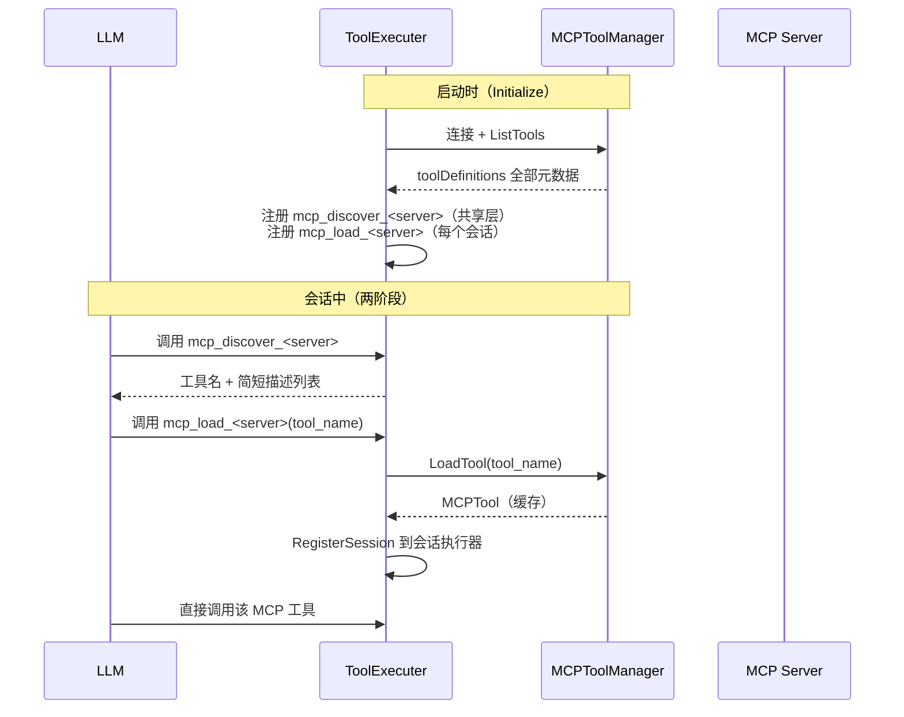
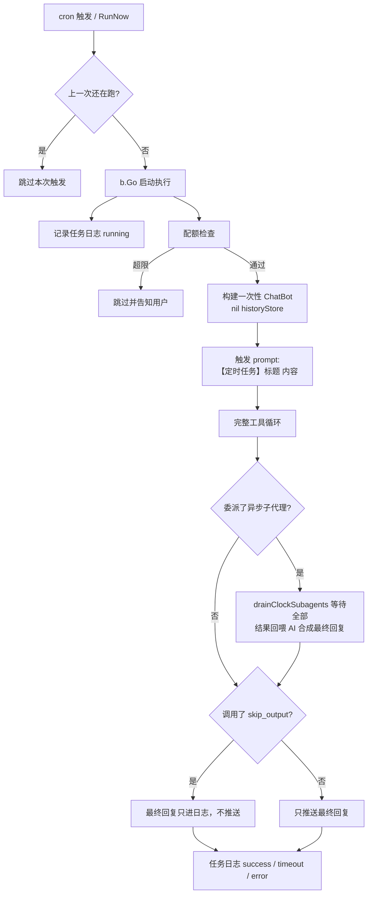

# AI 引擎（三）工具、MCP 与高级编排

本章介绍 Agent 的**能力扩展与高级编排**：工具如何定义与执行、MCP 如何两阶段懒加载、Skill 系统、AI 定时任务、会话运行器与任务注册表、子代理与后台交接、看门狗、Agent 团队、知识库与配额、钩子与工具门禁。

## 工具系统

### 工具抽象

一个工具是嵌入 `llmtool.BaseTool[ParamsType]` 的结构体，参数结构体用 `json` 标签命名、`desc` 标签描述：

```go
type EchoParams struct {
    Text string `json:"text" desc:"要回显的文本"`
}

type EchoTool struct {
    llmtool.BaseTool[EchoParams]
}

func NewEchoTool() *EchoTool {
    return &EchoTool{BaseTool: llmtool.MakeBaseTool("echo", "回显文本", EchoParams{})}
}

func (t *EchoTool) Execute(ctx context.Context, params any, callbacks llmtool.CallBackFuncs) (string, error) {
    return params.(*EchoParams).Text, nil
}
```

### 反射自动生成 Schema

`parser.go` 用 Go 反射从参数结构体自动生成 OpenAI 兼容 function schema——**无需手写 JSON Schema**：

- 字段类型映射：int/float→`number`，bool→`boolean`，slice→`array`，struct→`object`，其余→`string`
- 无 `omitempty` 的字段自动进 `required`；嵌套 struct / slice 递归解析
- MCP 工具则直接把 `inputSchema` 转为 OpenAI 格式（补充 `type/properties` 默认值与描述、枚举描述、required 排序）

### 确定性输出

工具列表按**名称排序**输出：Go map 遍历顺序随机，若直接序列化会导致每次请求 tools 字段排列不同，把上游 prompt 前缀缓存（DeepSeek context caching）全部打失。工具未找到的错误文本、skill 列表等一切回填给 LLM 的文本也都保证排序确定性。

### 执行器分层：共享 + 会话

```go
type ToolExecuter struct {        // 共享层：内置工具 + MCP manager
    tools       map[string]Tool
    mcpManagers []*MCPToolManager
}
type SessionToolExecutor struct { // 会话层：每个会话独立
    shared       *ToolExecuter
    sessionTools map[string]Tool  // 动态加载的 MCP 工具 + 会话绑定工具
}
```

- 每个会话创建独立的 `SessionToolExecutor`，`mcp_load` 等动态工具互不影响
- 同名工具会话层优先（定义与实际执行一致，避免重复 function 定义被提供方 400 拒绝）
- `SessionToolExecutor` 用 RWMutex 保护会话工具表：同一轮多个工具并行执行，`mcp_load` 并发写与其他工具读不会触发 Go map 并发 fatal

### 内置工具注册层级

| 层级 | 内容 |
| --- | --- |
| `CreateDefaultTools()` | 常开：`time`、`get_msg_history`、`get_private_file_url`、`load_images`；配置门控：`bash`（黑白名单正则）、`send_file`、`local_image`、`computer_use` 工具组（`screenshot`/`mouse_click`/`mousemove`/`mouse_scroll`/`keyboard_type`/`keyboard_press`/`active_window`/`list_windows`，仅 Windows 宿主机注册）。**联网搜索/浏览不再内置**，改由内置 `web` 技能 + CLI 提供（见下节） |
| `CreateToolsWithMCP()` | 追加 MCP 工具（`mcpLazyLoad` 决定发现/加载模式或全量注册） |
| `CreateToolsWithSkill()` | 追加 `skill_read` / `skill_reload` 工具与 SkillManager（同时加载内置技能） |

另由 aichat 插件在会话层注册：`config_get`/`config_set`（配置中心读写，敏感字段掩码、仅注册键可写、重启生效——重启由管理员发送 `/reboot` 命令执行，AI 只负责引导）、`config_file_get`/`config_file_set`（扩展配置读写：`files.mcp_json`/`files.prompt_json`/`files.hooks_json`/`files.commands_json`，只校验 JSON 语法，hooks/commands/prompt 保存后数秒热生效、mcp 重启生效）、`mcp_list`/`mcp_add`/`mcp_remove`/`mcp_reconnect`（MCP 服务器自管理，写 `files.mcp_json` 持久化 + 运行时热注册/注销）、会话绑定的 clock/memory/knowledge/team/subagent 工具，以及主会话的 `task_handoff`（后台交接）。其中配置修改类工具（`config_set`/`config_file_set`）执行前恒需管理员审批（与审批开关无关，请求者本人不能批准）。

### 回调桥（CallBackFuncs）

工具不直接接触平台，而是通过回调桥发送消息：

```go
type CallBackFuncs struct {
    SendText          func(text string) (string, error)
    SendImage         func(bs64content string) (string, error)
    SendFile          func(name, bs64content string) (string, error)
    GetPrivateFileURL func(fileId string) (string, error)
    LoadImages        func() (string, error)
    TakeLoadedImages  func() []string
    LoadLocalImage    func(path string) (string, error)
    // 工具结果长度治理与读回（超长结果落盘，AI 用 read_tool_output 读取）
    LimitToolResult func(toolName, result string, isError bool) string
    ReadToolOutput  func(handle string, offset, limit int, fromEnd bool, pattern string) (string, error)
}
```

主会话的回调把文本/图片/文件经 `bot.Bot` 发到当前群/私聊；框架不再自动用 `SendText` 发送工具轮中间文本（非流式只发最终回复，流式由 `streamReply` 覆盖式展示），该回调保留给工具显式发送消息。定时任务与子代理的回调则**丢弃 `SendText` 内容**（只记日志），只允许工具显式发送图片/文件，最终回复由编排层统一推送。

### 工具结果长度治理（落盘 + read_tool_output）

所有工具回填给 AI 的结果都在 `ToolOrchestrator.executeToolCalls` 统一治理（只有这一个出口，内置/会话/平台/MCP 工具一视同仁），避免单个工具返回 MB 级内容把一轮工具循环直接撑爆，或永久留在窗口历史里逐轮重发：

- 成功结果 rune 数 ≤ `plugin.ai_chat_bot.tool_result.max_inline_runes`（默认 16000）→ 原样回填
- 超过上限 → 完整内容写入会话临时文件（`<dir>/<sha256(会话键)[:8]>/<handle>.txt`，默认 `./data/tool-outputs`），回填「预览（默认 4000 字符，头 3/4 + 尾 1/4）+ handle + read_tool_output 读取方式」；Query 日志与 PostToolUse 钩子拿到的是治理后的文本
- 错误结果 **不落盘**，只做头尾截断（模型必须当轮看到失败原因）；落盘失败/功能关闭同样退化为头尾截断
- `read_tool_output` 是共享层工具（落盘启用时注册），支持 `offset`/`limit`/`from_end`/`pattern`（字面子串，非正则），自身输出有硬上限（8000 rune / 2000 行 / 单行 2000 rune），且**豁免**再次落盘；handle 只能读取所属会话目录，过期（默认 24h）提示重新执行原工具
- 落盘文件由后台 janitor 按 `retention_hours` / `max_total_mb` 清理；`#新对话` 与未@自动清空历史时顺手删除对应会话目录
- 原 `bash.max_output`、MCP 8000 rune、`skill_read` 16000 rune 的**工具内截断已移除**：内容在工具内部被截掉后统一层再也拿不回原文，统一交给本机制处理

## MCP 两阶段懒加载

MCP（Model Context Protocol）接入通过 `modelcontextprotocol/go-sdk`，支持三种传输：**stdio**（子进程）、**Streamable HTTP**、**SSE**。



**为什么两阶段**：MCP 服务器可能暴露几十上百个工具，每个工具的描述都会进入 LLM 请求的 tools 字段——全量注册会让上下文爆炸。发现工具只读无副作用，加载按需进入会话；加载的工具在同一会话后续轮次中直接可用，与内置工具同权。

`plugin.ai_chat_bot.mcp.lazy_load`（默认 `true`）控制是否使用该模式：关闭后启动时全量注册所有 MCP 工具（`RegisterMCP`），工具列表恒定、上游 prompt 缓存命中率更高，但工具较多时上下文开销大。

其他细节：

- MCP 工具结果与其他工具一样经过统一长度治理：超过 `tool_result.max_inline_runes` 时完整内容落盘、回填预览 + handle，由 AI 用 `read_tool_output` 读回（工具内不再单独截断）
- 连接 HTTP 客户端不在整体 `http.Client.Timeout` 上设超时（会中断 SSE 长连接持续读取），改为 Transport 层 `DialContext` + `ResponseHeaderTimeout` 保护握手阶段
- 可选 `ToolFilterFunc`（前缀/名单/关键词/组合过滤器）在连接时过滤工具
- **运行时管理**：`ToolExecuter` 以 RWMutex 保护共享工具表与 manager 列表，支持启动后 `AddMCP` / `RemoveMCP` / `ReconnectMCP`（AI 的 `mcp_add` 等工具依赖此能力；重连后已加载到会话的旧工具句柄失效，需重新 `mcp_load`）

## Skill 系统

Skill 把领域知识封装成 `SKILL.md`（支持 frontmatter 的 `name` / `description`），AI **按需阅读**而非全量塞入：

- 目录结构：`skills/<name>/SKILL.md`（可带 reference.md、script.sh 等附属文件）或单文件 `skills/SKILL.md`
- **内置技能与外置技能**：内置技能随二进制发布（`bot/component/llmtool/builtinskills`，`//go:embed`），加载时物化到 `<skillsDir>/.builtin`（隐藏目录，脚本有可执行权限供 `bash` 调用）；内置技能**不可删除、不可禁用、不受 `skills` 白名单限制**。外置技能从 `skillsDir` 加载，可在面板「技能管理」页启用/禁用——禁用后描述不进入 `available_skills`，`skill_read` 也拒绝读取；禁用列表持久化在 `plugin.ai_chat_bot.skills_disabled`
- **内置 `web` 技能**：自带 CLI `webctl.py`，支持 DeepSeek / Tavily / Exa / Firecrawl / Jina AI 五个搜索抓取平台（`--deepseek` / `--tavily` / `--exa` / `--firecrawl` / `--jina`），AI 先 `skill_read` 拿到脚本绝对路径，再用 `bash` 执行 `search` / `fetch` / `providers` 子命令；需要 `bash` 工具与至少一个平台 Key 环境变量（`DEEPSEEK_API_KEY` / `TAVILY_API_KEY` / `EXA_API_KEY` / `FIRECRAWL_API_KEY` / `JINA_API_KEY`）。不带平台参数时脚本自动检测已配置的 Key，按 Tavily → Exa → Firecrawl → Jina AI → DeepSeek 的优先级选择（`WEB_SEARCH_PROVIDER` 可覆盖），`providers` 子命令列出各平台配置情况。新增搜索平台只需在 CLI 的 `PROVIDERS` 注册表增加实现，平台参数、环境变量自动检测与 `providers` 列表都会自动生成，无需改 Go 代码
- **内置 `aniabot` 技能**：让 AI 了解自己跑在什么框架上——组成与数据落点、配置键与生效时机、Web 面板各页、会话指令、插件/技能/MCP 机制与排障路径，用于回答「怎么配置 / 为什么没生效 / 要重启吗」并指导用户操作。主体 `SKILL.md` 只放高频结论，三份参考文档（`reference/config.md`、`reference/panel.md`、`reference/troubleshooting.md`）按需 `skill_read`；它不引入新机制，只是把框架事实写进上下文，**改配置键、面板页面或指令时要同步更新**（有测试校验内置技能可加载与参考文档可读）
- `SkillManager` 启动时加载，`Reload` 原子替换注册表（面板上传/删除/启停后热更新）并保留内置技能与禁用状态；常驻的 `skill_reload` 工具走 `Refresh`（按最近一次的目录与白名单原地重载），供 AI 经 `bash` 等直接编辑本地 skill 文件后刷新缓存
- system prompt 注入 `available_skills` 注册表（名称 + 一句话描述），模型判断需要时调用 `skill_read` 读取完整内容
- 输出确定性：skill 列表按名称排序（作为工具结果文本回填给 LLM）
- **AI 自管理技能**：开启 `plugin.ai_chat_bot.skill_tool.enable`（默认关闭）后，会话注册 `skill_list` / `skill_install` / `skill_remove` 三个工具——找资源不做专用搜索工具（GitHub API 搜索有频控），AI 可直接用内置 `web` 技能联网搜索技能仓库或 zip 直链，再从 zip 直链 / GitHub 仓库（自动转 codeload zip）/ SKILL.md 直链下载安装，或直接撰写 SKILL.md 全文创建技能；安装/卸载复用面板同款磁盘逻辑（zip-slip / 体积 / 校验防护，内置技能不可删除、名称冲突会被拒绝），热重载立即生效，操作记入操作日志
- **AI 自管理 MCP 服务器**：开启 `plugin.ai_chat_bot.mcp_tool.enable`（默认关闭）后，会话注册 `mcp_list` / `mcp_add` / `mcp_remove` / `mcp_reconnect` 四个工具——添加/删除经 DI 注入的 `ConfigEditor` 写入 `files.mcp_json` 持久化（名称校验满足 LLM 工具名规范，环境变量/请求头以 `KEY=VALUE` 列表传参），同时调用 `ToolExecuter.AddMCP` / `RemoveMCP` 运行时热注册/注销立即生效（持久化失败会回滚运行时注册；删除时运行时未注册的服务器容忍注销错误，保证配置层面删除总可用）；`mcp_reconnect` 对启动时连接失败从未注册的服务器会从配置读取定义重新注册

## AI 定时任务（clock）

与框架 `StartCron` 静态任务不同，clock 任务由 AI / 用户**动态创建**、持久化保存、重启不丢：

- `clockManager` 拥有**独立 `*cron.Cron`**（不与框架共享），任务存 `clock:` 命名空间（`task:<id>` + `index` + `seq`）
- 支持 5 字段 cron、`@every` 等、单次任务（`run_once` 执行后自动销毁）、按目标（群/好友）隔离

### 触发执行



- 每次触发**全新一次性上下文**（nil historyStore，执行完丢弃），带完整工具能力
- 超时 `clock.default_timeout_sec`（默认 120），超时后发消息告知用户
- 执行日志走 `bot/component/tasklog`（`ania_task_log` 行级），记录工具调用明细、token 用量、最终回复；进程重启后遗留的 running 记录标记为 `interrupted`
- 中间轮文本丢弃，只有最终回复推送给目标；工具显式发送的图片/文件正常发出
- `skip_output` 工具（`clockskip.go`，仅在任务会话注册）：AI 判断本次无需汇报时调用，收尾输出（含子代理结果汇总后的合成轮）只记入执行日志、不推送给目标，供巡检/监控类任务保持安静；跳过标记与原因随任务日志落盘（面板与 `/clock log` 可见）
- 播报提示（`noteDelivered` / `deliveryHint`）：成功推送（最终回复、工具发出的图片/文件）后按目标会话记一个投递序号；用户在该会话的下一轮发言里，提示以尾部注入的方式拼在用户消息前（请求成功后才 `commitDeliveryHint` 记账，失败轮次会重新注入；`PersistUserText` 保证它不进入历史回放），指引 AI 先用该会话可用的 `*_get_msg_history` 工具确认播报内容——任务会话与主对话的历史互不相通，不提示的话用户对着播报追问时 AI 只能反问
- 用户经 `/clock` 管理，AI 经 `clock_create/list/update/delete/log` 工具管理

## 会话运行器与任务注册表

AI 消息入口不再在框架事件 goroutine 里跑完整个回合（`runner.go`）：`OnGroupMsg`/`OnFriendMsg` 只做去重、自过滤、命令与 mention 门，然后把消息入队并立即返回；后台 goroutine 按会话串行接管队列。

- **入口零阻塞**：`submitTurn` 入队后 `b.Go("runner:<session>")` 唤醒运行器；同一会话同一时刻只有一个回合（会话锁），跨会话并发受 `rate_limit`（默认 4）槽位限制。长回合不再占用框架事件 worker，也不受 `bot.msg_event_timeout_sec` 约束。
- **回合上下文**：`context.WithoutCancel(parent)` 保留 Value（追踪、图片注册表）但丢弃框架 deadline；关联插件生命周期 `p.runCtx`（`OnUnload` 取消）；`turn.hard_timeout_sec`（默认 14400s，0=不限）叠加硬截止。
- **长任务受理提示**：回合运行超过 `turn.ack_after_sec`（默认 20s）仍无可见输出（流式首字/最终发送）时，先发一条「正在处理」提示，每回合最多一条。
- **排空循环**：每批处理完继续 drain 队列；出错/取消时该批用户消息之外的行为由错误处理决定（`/stop` 是显式停止，会清空该会话排队队列）。
- **任务注册表**（`taskstore.go` + `tasktrack.go`）：回合与异步子代理各写一行 `ania_agent_task`（`id` 形如 `t-<36进制纳秒>-<4位hex>`，含 `session_key/parent_id/kind/status/title/prompt/result/error/stop_reason/tokens/meta/时间戳`），状态机 `queued → running → completed|failed|timeout|cancelled|interrupted`，停止原因 `completed|aborted|max_tokens|error|watchdog|timeout|user_stop`。任务表写入走 3 秒独立 ctx，DB 卡住不影响回合；建表失败降级为不持久化（不阻断启动）。
- **重启恢复**：启动时 `MarkInterrupted` 把残留的 `queued/running/waiting` 标记为 `interrupted`；默认不自动续跑，用户发 `/resume <任务ID>` 把本会话的 `interrupted` 子代理/交接任务重新入队（任务目标作为系统来源消息），由主 AI 带着会话历史继续。
- **清理**：按 `task.retention_days`（默认 7 天）每 6 小时删除已结束且过期的任务记录。
- **用户命令**：`/tasks`（本会话运行中子代理 + 最近任务，含状态/耗时/类型/停止原因/token）、`/stop`（取消当前回合并清空本会话排队）、`/stop <任务ID>`（只取消指定后台子代理）、`/resume <任务ID>`。

## 子代理（subagent）

`subagent_run` 让主 AI 委派复杂/耗时子任务给**一次性子代理**（`subagent.enable` 默认开启；关闭后不注册子代理与交接工具）：

- 子代理是全新 `ChatBot`（nil historyStore，执行完丢弃），独立 `SessionToolExecutor`，拥有与主 AI 一致的会话级工具（clock/memory/knowledge），但**不再注册 subagent 自身与团队工具**（防递归，深度天然为 1）
- 中间轮文本丢弃；发送图片/文件、读历史仍作用于当前会话
- 图片状态隔离：子代理有自己的图片队列，`LoadImages` 是 stub（推迟给主 AI），避免两个工具循环互踩队列
- 执行参数全部跟随主模型：模型与 API 格式直取主模型四元组（`subagentLLMConfig`），生成参数经 `buildSubagentChatOptions` 复用主模型配置，工具轮数取 `mainMaxIterations()`（主模型的最大工具调用轮数）
- **异步语义**：工具启动受跟踪的 goroutine（`b.Go`）后立即返回任务 ID；完成时格式化结果（`【子代理执行完成】…`）作为合成消息入该会话 pending 队列并唤醒运行器，由主 AI 在后续回合处理。主回合不等待、不轮询
- **结果治理**：同步路径（团队/定时任务复用 `runSubagentWithOptions`）的最终文本作为工具结果返回、仍经过统一工具结果治理；异步路径按 `subagent.result_inline_runes`（默认 8000）处理——超长结果由 `toolResultLimiter.LimitAt` 落盘为会话私有文件，合成消息只带摘要 + handle，主 AI 用 `read_tool_output` 读取
- **并发边界**：每会话 `subagent.max_concurrent_per_session`（4）与全局 `subagent.max_concurrent_global`（8）两个信号量，全局池与对话回合的 `rate_limit` **分开计算**；超出直接返回可读错误，不静默排队。`/stop` 与 `subagent_cancel`/`/stop <ID>` 按 ID 取消；`OnUnload` 取消全部后台子代理
- **命名与运行中通信（P2 未实现）**：当前子代理只有启动时生成的任务 ID（`t-…`），不支持自定义名字、`send_message` 追加指令、结构化 `status/summary/artifacts` 返回或跨重启续跑；这些属于方案文档 P2 的 Subagent 2.0 计划，`subagent_list` 目前返回 ID/任务摘要/运行时长

### 超时预算

```go
func resolveSubagentTimeout(defaultTimeout time.Duration, timeoutSec int, parentCtx) (timeout, error) {
    // 1. 默认超时 = subagent.default_timeout_sec（默认 1800s=30min，0=不限制）
    // 2. timeoutSec>0 时覆盖默认值，先限幅 int 再乘 time.Second（防溢出）；业务上限 subagent.max_timeout_sec（0=不限）
    // 3. 仅当父上下文真有 deadline（父回合硬截止）时，预留 30s 收尾并压缩到剩余预算；不足时缩到剩余量一半、保底 10s
}
```

超时与框架消息事件预算**彻底解耦**：`bot.msg_event_timeout_sec` 只约束框架事件入口，不再作为子代理默认超时。子代理自身超时以错误结果返回，让主 AI 用剩余时间收尾；`/stop` 通过异步子代理组的 cancel 取消。

### 定时任务专属：异步子代理

clock 任务里注册的是**异步**子代理变体（`clocksubagent.go`）：子代理在后台并发执行（`subagent_run`/`subagent_list`/`subagent_cancel`），任务收尾时 `drainClockSubagents` 等待全部完成（预留 30s 合成预算），把结果回喂给同一个一次性 ChatBot 做多轮合成（上限 5 轮），只推送最终合成的回复。子代理超时随剩余预算收缩。

## 后台交接（task_handoff）与看门狗

- **`task_handoff`**（主会话、`subagent.enable=true` 时注册）：模型把「已完成摘要 `summary` + 剩余工作 `remaining` + 验收标准 `acceptance`」交给后台子代理继续，当前回合立即结束。工具内部把三段拼成自包含的后台任务提示词，复用异步子代理通道（kind=`handoff`），完成后结果照常回到会话。软截止提醒会明确引导模型调用它，把「超时」变成「换一个地方继续做」。
- **委派提醒**：同一回合工具轮数达到 `turn.progress_reminder_after`（6）时注入一次「考虑用 `subagent_run` 拆出独立部分」提醒。
- **重复/无进展看门狗**（`bot/component/aichat/toolwatchdog.go`）：同一轮工具调用的签名 = 排序后的 `name+args`；签名连续不变时按 `turn.repeat_tool_warn`（`3,5,8`）各注入一次换方案提醒，达到 `turn.no_progress_limit`（12）时返回 `aichat.WatchdogAbortError` 终止工具循环（`0` 只提醒）；提醒以 user 角色追加并随本轮返回进入历史，后续回合模型仍能看到。
- **单请求内上下文保护**：每步 LLM 返回的 prompt token 超过窗口 85% 时，把较旧的大工具结果裁剪为「标记 + 原始长度 + 头尾片段」（保留最近 6 条消息与 tool_call 配对），窗口级压缩仍由回合开始时的 `messageWindow` 负责。

## Agent 团队（team）

在子代理之上的一层编排：AI 可保存/调用「团队」——一组带角色描述的子代理成员（默认启用，无配置开关）：

- 团队按 scope（`g:` / `f:` / 全局 `global`）隔离，`team:` 命名空间 KV 存取；团队名严格校验（中文/字母/数字/下划线/连字符）
- `team_run` 让多个成员**并行**执行（上限 `teamMaxMembers`=5，防并发风暴），每个成员复用 `runSubagentWithOptions` 并只传角色提示词——模型与执行参数（超时/轮数）全部与普通子代理一致（即跟随主模型）
- 成员结果汇总返回主 AI；团队定义可保存复用（`team_create/list/delete`），面板提供管理页
- 团队成员的一次性会话不注册团队工具（防递归组建团队）

## 知识库（knowledge）

`kb_add` / `kb_search` 等工具让 AI 把完整资料存入知识库并按需检索：

- 作用域：会话库（`g:` / `f:`）+ 全局库（`global`，所有会话可检索，仅面板可管理）
- **长文档切片**：入库时按 600 字符一块、60 字符重叠切片，检索命中块而非整篇，避免无关内容占用上下文
- 向量检索可选（与长期记忆共享 `embedder`）：每块一个 embedding（float32），检索按余弦相似度加分；embedding 服务不可用自动退化为纯关键词
- 去重（标题+内容规范化）、上限（`kb.max_docs`）、截断（8000 符文）
- **行级存储**：每篇文档一行（`ania_kb_doc`，`(scope,id)` 联合主键，tags/embedding 为 JSON 列），增删改只写单行；旧版「每作用域一个 JSON 数组」的 KV 数据在启动时一次性迁移入表，探测或建表失败时该功能禁用

## 配额与用量统计

- **quotaManager**：按「每会话每日」+「全局每日」两个维度限制 token 消耗，键 `daily:<日期>:<会话key>` 天然按天过期；Check-Add 为宽松语义（非硬实时），面板可查看用量
- **usageAcc**：goroutine 安全的派生用量累加器，归集主循环之外的消耗（异步子代理、team 成员、备用识图），收尾并入统计与配额
- **Query 日志**：一次「触发 → 最终响应」的完整记录（`ania_query_log` 行级），含用户输入、发送者、工具调用明细（工具结果记录统一长度治理后的文本，超长结果以预览 + handle 落盘）、token、状态（running/success/skipped/stopped/timeout/error），日志不淘汰，面板「Query 日志」页按条件筛选并支持导出/清除；主动互动的执行同样落在这里（`kind=proactive`，以触发说明替代用户输入，保持安静时状态为 skipped 并在 note 记录原因），Token 统计按来源单列

## 钩子系统（hooks）

`bot/component/agenthook` 提供会话生命周期钩子，两种形态共存：

- **Shell 钩子**（管理员配置）：面板「扩展配置」页编辑 `files.hooks_json`，在事件触发时执行配置的命令。载荷经 **stdin 以 JSON** 传入（`hook_event_name/session_id/agent_kind/tool_name/tool_input/tool_result/prompt`），退出码语义对齐 Claude Code：**0=通过**（stdout 作为上下文注入）、**2=阻断**（stderr 作为原因）、**其他=非阻断错误**（仅记日志）；超时（默认 10s，按条可覆盖，上限 60s）按非阻断错误处理
- **Go 钩子**（插件开发者）：插件实现 `agenthook.Handler` 接口（`OnAgentHook(ctx, event, payload) Result`），core 在启动后收集所有实现者，经 `HandlerRegistry` 扇出注入 pluginaichat；Go 钩子先于 shell 钩子执行，panic 自动隔离

事件一览：

| 事件 | 时机 | 可阻断 |
| --- | --- | --- |
| `SessionStart` | 会话（重）创建 | 否；产出的上下文在下一轮对话注入一次 |
| `UserPromptSubmit` | 用户消息进入对话前 | 是（回复原因给用户）；可注入上下文 |
| `PreToolUse` | 每个工具执行前（可按 `matcher` 正则匹配工具名） | 是（工具结果回填原因，循环继续） |
| `PostToolUse` | 每个工具执行后 | 否（仅通知） |
| `Stop` / `SubagentStop` | 主回复完成 / 子代理完成 | 否 |
| `PreCompact` | 上下文压缩即将发生 | 否 |

管理器以 5s TTL 重读配置中心，raw 变化才重新编译正则（面板编辑秒级热生效）；任一钩子阻断即短路后续钩子。引擎层（`aichat`）只依赖窄接口 `HookRunner`，自身不碰 shell——依赖方向保持 `aichat → agenthook → functool`，无反向依赖。

## 工具门禁管线

每个工具调用在 goroutine 内、真正执行前经过请求级门禁（`ChatOptions.PreToolGate`），顺序固定：

1. **计划模式**（内存判断，最便宜）：`/plan on` 期间副作用工具（bash/file/config_set/config_file_set/鼠标键盘输入类 mouse_click/mousemove/mouse_scroll/keyboard_type/keyboard_press/记忆写/知识库写/clock 增删改/skill/mcp 管理/子代理/团队）直接阻断，`todo_write` 刻意放行（清单是规划工作流的一部分）；screenshot/active_window/list_windows 为只读观察，不阻断（计划模式下 AI 可以看屏幕做分析）
2. **PreToolUse 钩子**（shell 有界 10s）
3. **管理员审批**：配置修改类工具（`config_set`/`config_file_set`）恒需管理员回复「允许」才执行，请求者本人不能批准，与审批开关无关。审批提示优先私聊发给管理员（`requestAdminOnly`：待批请求同时登记在发起会话键与管理员私聊索引，两处回复均可批），管理员私聊发送失败时回退到发起会话；无权者的审批回复会被消费并提示
4. **人工审批**（等真人，最贵放最后——已被否决的工具不再打扰用户）：`approval.tools` 列出的工具由请求者或管理员批准

阻断文本作为该工具的结果消息回填（语义等同工具报错），循环继续，面板 Query 日志可见被拦调用。门禁在 goroutine 内调用而非 spawn 前统一调用：审批等待不阻塞同轮并行工具的启动。

## 任务清单（todo_write）

内存态、按会话隔离的任务清单工具（全量替换语义，对齐主流 agent）：校验 status 合法性、单一项 in_progress、条数/字数上限；空数组即清空。仅注册到主会话（子代理/定时任务的一次性会话不共享父清单）。有未完成项时在后续对话**尾部注入** `<todo_reminder>` 提醒，内容哈希去重——清单没变不重复注入，避免每轮污染上下文。

## 工具审批与 bash 三段式

`approvalManager`（pluginaichat）：配置工具执行前向会话发送确认消息，请求发送者或管理员回复「允许/同意/allow/yes」或「拒绝/deny/no」决定放行，超时（默认 120s，钳制 10~240s）自动拒绝；结论写入操作日志（`tool_approval`）。回复拦截位于消息入口**第一行**（审批等待期间会话锁被占、回复通常不带 @）；每会话互斥锁把并行工具触发的多个审批串行化逐个提示；`/stop` 经同一 context 取消等待。子代理/定时任务路径 requester 为 0，仅管理员可批。

bash 工具为命令级三段式：黑名单命中→拒绝；白名单命中→放行；都不命中（含均未配置）→ 经 `CallBackFuncs.RequestApproval` 走上述审批，审批未启用（`RequestApproval` 为 nil）时默认放行。`RequestApproval` 在并行回调包装层（`lockedCallbacks`）**透传不加锁**——审批阻塞 ~120s，进互斥锁会卡死同轮其他工具的 SendText。

## 电脑操作（computer use）工具组

`bot/component/computeruse`（OS 层）+ `functool/computeruse.go`（工具层），按 `plugin.ai_chat_bot.computer_use.enable` 注册，**仅 Windows 宿主机**：底层用纯 syscall 实现（GDI `CreateDIBSection`/`BitBlt` 截图、`SendInput` 注入鼠标键盘、`EnumWindows` 枚举窗口），无 CGO，其他平台编译为 `ErrUnsupported` 桩（首次截屏/取坐标时声明 DPI 感知，高分屏截图便不模糊、坐标不错位）。

- **坐标空间**：AI 的点击/滚动/区域截图坐标基于「最近一次 screenshot 的图像」；截图工具按「原点 + 缩放」更新共享 `View`（区域截图原点偏移、`max_width` 降采样都折算在内），输入工具据此换算回虚拟桌面像素（多显示器负原点支持）
- **截图回传**：截图写临时文件后复用 `LoadLocalImage` 管线（多模态推队列 / OCR 备用识别），读完即删，不动 `CallBackFuncs` 接口
- **安全**：输入类工具（mouse_click/mousemove/mouse_scroll/keyboard_type/keyboard_press）纳入计划模式阻断名单；每次操作写 oplog 审计（`screenshot`/`mouse_click`/…）；可加入 `approval.tools` 逐次人工确认

## 自定义斜杠命令

`commandManager` 把 `/名 参数` 映射为提示词模板（`files.commands_json`，5s TTL 热生效）：命中后消息被改写为展开后的单文本段（`$args` 替换为参数，无占位符则追加），走正常对话流程（排队/批处理/知识库/记忆注入不变）。名称受正则约束且不得撞内置命令；`/cmd add/del` 仅管理员。

## 下一步

- [AI 引擎（一）LLM 客户端与对话循环](/internals/agent-llm) —— 循环底层
- [AI 引擎（二）上下文、历史与记忆](/internals/agent-context) —— 状态管理
- [技术原理总览](/internals/)
